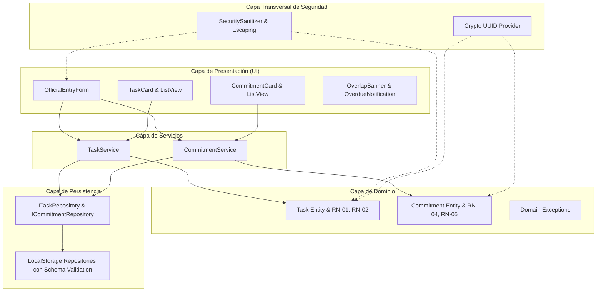

# Cronos & Co. — Agenda de Tareas y Compromisos: Plan de Implementación

> **Metodología:** Cascada (Waterfall SDLC) | **Fases:** Fase 3 (Implementación) y Fase 4 (Verificación)
> **Referencia de Especificación:** [docs/superpowers/specs/2026-10-29-cronos-agenda-cascada-design.md](file:///c:/Users/LENOVO/agenda/docs/superpowers/specs/2026-10-29-cronos-agenda-cascada-design.md)

**Goal:** Construir de manera determinista la aplicación web editorial de gestión de tareas y compromisos Cronos & Co. en TypeScript estricto, con arquitectura por capas, capas de seguridad transversal, persistencia aislada y suite automatizada de pruebas unitarias.

**Architecture:** La solución implementa Clean Architecture con cuatro capas concéntricas: Dominio (entidades, excepciones y reglas de negocio puras), Repositorios (almacenamiento aislado con sanitización JSON), Servicios (casos de uso de negocio RN-01 a RN-05) y Presentación (UI reactiva bajo el sistema de diseño Cronos & Co. con prevención activa de XSS).

**Architecture Diagram:**

**Tech Stack:** TypeScript 5.x, Vite 6.x, Vanilla CSS (tokens Cronos & Co., Google Fonts), Vitest, HTML5 semántico.

## Global Constraints
- Tipado estricto habilitado en `tsconfig.json` (`strict: true`, `noImplicitAny: true`).
- Prohibido el uso de `any` o conversiones no seguras.
- Sanitización estricta anti-XSS y uso de `textContent` para renderizado de texto de usuario.
- Generación de UUIDs mediante `crypto.randomUUID()`.
- Respetar al 100% los contratos e interfaces del SDD (`sdd-agenda-tareas.md`).
- Respetar el 60/40 cromático y reglas tipográficas de `cronos_co._design_system.md`.

---

### Task 1: Andamiaje del Proyecto, Herramientas de Seguridad y Configuración
- Configurar `package.json`, `tsconfig.json`, `vite.config.ts`.
- Instalar Vite y Vitest como dependencias de desarrollo.
- Implementar módulo de seguridad transversal `src/security/sanitizer.ts` (escapeHtml, sanitizeInput, validateEmailRfc5322).
- Crear suite de pruebas de seguridad `tests/security.test.ts`.

### Task 2: Capa de Dominio (Entidades, Enums y Excepciones)
- `src/domain/types.ts`: `Priority`, `TaskStatus`, `CommitmentStatus`, DTOs.
- `src/domain/exceptions.ts`: `DomainException`, `TaskValidationException`, `ScheduleConflictException`, `SecurityValidationException`.
- `src/domain/task.ts`: Clase `Task` con validaciones de RN-01, longitud máxima (100 y 500) y transición de estados RN-02.
- `src/domain/commitment.ts`: Clase `Commitment` con validaciones de RN-04 (duración >= 15 min), RN-05 (RFC 5322), verificación de orden temporal (`fechaFin > fechaInicio`).
- Pruebas unitarias de dominio `tests/domain.test.ts`.

### Task 3: Capa de Repositorios con Persistencia Segura
- `src/repositories/task.repository.ts`: Interfaz `ITaskRepository` e implementación `LocalStorageTaskRepository` con serialización segura y parseo a prueba de polución de prototipos.
- `src/repositories/commitment.repository.ts`: Interfaz `ICommitmentRepository` e implementación `LocalStorageCommitmentRepository`.
- Pruebas de repositorio `tests/repositories.test.ts`.

### Task 4: Capa de Servicios de Aplicación
- `src/services/task.service.ts`: `createTask`, `updateTaskStatus`, `getPendingTasksOverdue`, `getAllTasks`.
- `src/services/commitment.service.ts`: `scheduleCommitment`, `cancelCommitment`, `hasScheduleConflict`, `getAllCommitments`.
- Pruebas unitarias completas de servicios `tests/task.service.test.ts` y `tests/commitment.service.test.ts` verificando RN-01 a RN-05.

### Task 5: Capa de Presentación (UI Cronos & Co.) y Sistema de Estilos
- `index.html`: Estructura semántica, fuentes `Cinzel`, `Playfair Display`, `Instrument Serif`, `Plus Jakarta Sans`, `JetBrains Mono`.
- `src/style.css`: Tokens de diseño `--blanco`, `--pastel-1` a `--pastel-5`, halos Aurora Gradient, ruido de papel verjurado, contrastes WCAG AA/AAA y responsividad (< 640px, 641-1024px, > 1025px).
- `src/ui/components/`: Componentes para `TaskCard`, `CommitmentCard`, `OfficialEntryForm` (con tabs, contadores en tiempo real de 100 y 500 caracteres, chips de participantes con distintivo `Creador`), `OverlapBanner` y alertas de vencimiento.
- `src/main.ts`: Inicialización de la aplicación y enlace reactivo.

### Task 6: Verificación, Pruebas Automatizadas y Validación en Navegador
- Ejecución completa de suite Vitest.
- Verificación en navegador y reporte de entrega final de cascada.
