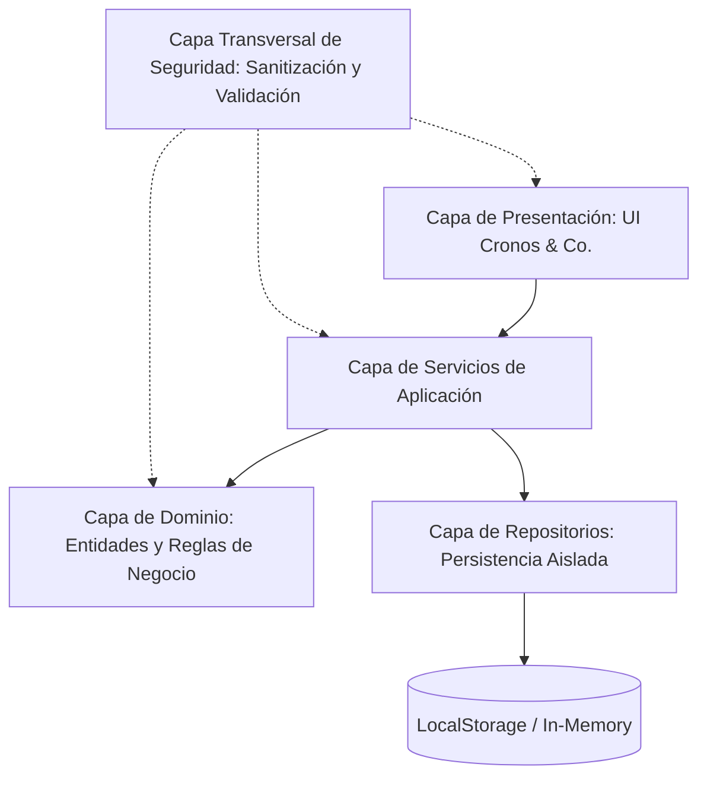

# Especificación de Diseño: Cronos & Co. — Agenda de Tareas y Compromisos
**Metodología:** Cascada (Waterfall SDLC) | **Versión:** 1.1.0

---

## 1. Visión General del Sistema y Reglas de Negocio
Sistema de gestión de tareas individuales y compromisos colectivos bajo el diseño editorial y paleta Aurora Vintage de *Cronos & Co.*, implementado con tipado estricto POO en TypeScript, arquitectura desacoplada y capas de seguridad integradas.

### 1.1 Reglas de Negocio (Business Rules)
1. **RN-01 (Validación de Fechas de Tareas):** `fechaVencimiento >= now` al crear o actualizar tareas. Violación dispara `TaskValidationException`.
2. **RN-02 (Transiciones de Estado de Tareas):** Estados `COMPLETADA` o `CANCELADA` son terminales; no pueden transicionar a `EN_PROCESO` o `PENDIENTE`. Violación dispara `TaskValidationException`.
3. **RN-03 (Sin Solapamiento de Compromisos):** No se permiten compromisos traslapados para el mismo usuario en estados `PROGRAMADO` o `CONFIRMADO`. Rango de traslape: `(NuevoInicio < ExistenteFin) && (NuevoFin > ExistenteInicio)`. Violación dispara `ScheduleConflictException`.
4. **RN-04 (Duración Mínima):** `(fechaFin - fechaInicio) >= 15 minutos`. Violación dispara `TaskValidationException`.
5. **RN-05 (Validación de Participantes):** Correos electrónicos de asistentes validados estrictamente bajo RFC 5322. Mínimo 1 participante requerido (creador).

---

## 2. Capas de Seguridad (Security Layers)
En cumplimiento con el requerimiento de seguridad de nivel de producción:
1. **Sanitización y Codificación Anti-XSS (Input/Output Defense):**
   - Codificación contextual de entidades HTML antes de la inyección en el DOM para `titulo`, `descripcion`, `ubicacion` y `etiquetas`.
   - Inserción estricta mediante `textContent` y creación programática de nodos DOM (`document.createElement`).
2. **Defensas contra Polución de Prototipos e Inyección en Almacenamiento:**
   - Validación de esquema en tiempo de ejecución al deserializar registros desde `localStorage`.
   - Limpieza de claves reservadas (`__proto__`, `constructor`, `prototype`).
3. **Criptografía Determinista para Identificadores:**
   - Empleo exclusivo de `crypto.randomUUID()` estandarizado para generación de llaves primarias.
4. **Restricciones de Límites y Payloads:**
   - `titulo`: límite estricto de 100 caracteres; recorte de caracteres invisibles o de control.
   - `descripcion`: límite estricto de 500 caracteres.
   - `minutosRecordatorio`: entero positivo `[0, 10080]`.

---

## 3. Arquitectura del Software

### 3.1 Capa de Dominio (`src/domain/`)
- `Task`: Atributos inmutables en id, encapsulamiento de estado con `changeStatus()`, validación de `fechaVencimiento`.
- `Commitment`: Validación de intervalo `>= 15 min`, validación de participantes RFC 5322, estado `cancel()`.
- Excepciones: `DomainException`, `TaskValidationException`, `ScheduleConflictException`, `SecurityValidationException`.

### 3.2 Capa de Repositorio (`src/repositories/`)
- Interfaces `ITaskRepository` y `ICommitmentRepository`.
- Implementaciones seguras `LocalStorageTaskRepository` y `LocalStorageCommitmentRepository` con serialización controlada.

### 3.3 Capa de Servicios (`src/services/`)
- `TaskService`:
  - `createTask(dto: CreateTaskDTO): Task`
  - `updateTaskStatus(id: string, newStatus: TaskStatus): Task`
  - `getPendingTasksOverdue(now: Date): Task[]`
  - `getAllTasks(): Task[]`
- `CommitmentService`:
  - `scheduleCommitment(dto: CreateCommitmentDTO): Commitment`
  - `cancelCommitment(id: string): void`
  - `hasScheduleConflict(userId: string, start: Date, end: Date): boolean`
  - `getAllCommitments(): Commitment[]`

### 3.4 Capa de Presentación (`src/ui/` y `style.css`)
- Aplicación de tokens de color Cronos & Co.: `--blanco` (60%), `--pastel-1` a `--pastel-5` (40%).
- Tipografías: Cinzel, Playfair Display, Plus Jakarta Sans, JetBrains Mono.
- Componentes reactivos modulares, contadores de caracteres en vivo, insignias de validación de intervalo, advertencia de tareas vencidas y banners de solapamiento.
